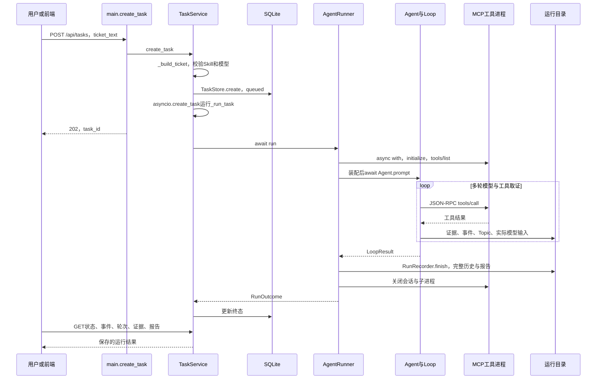
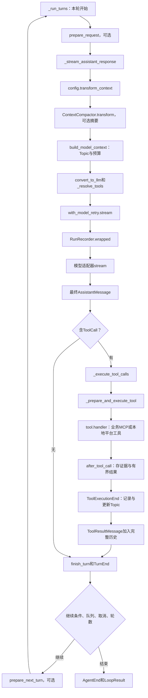
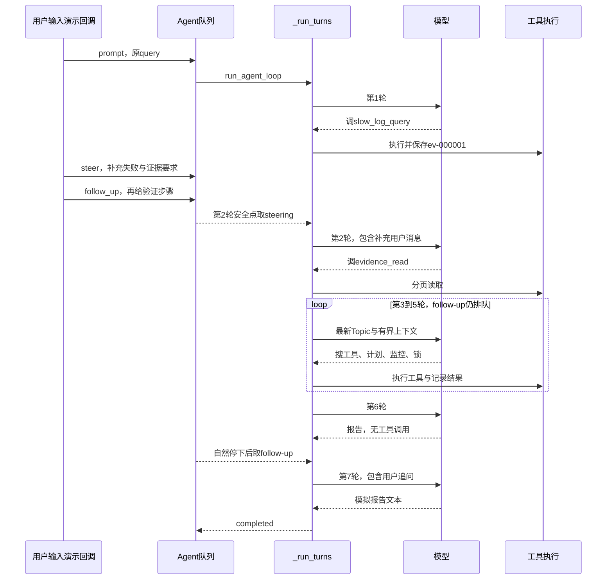
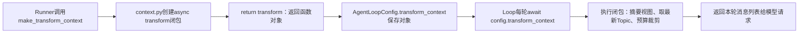
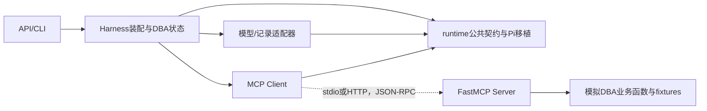

# Architecture Diagrams

这些图对应 [完整导读](ARCHITECTURE.md) 第 7 节。函数源码位置见 [可维护索引](QUERY_CALL_CHAIN.md)。
置信度均为高：入口来自路由/服务代码，动态 Hook 和多轮语义由行为测试及实际运行记录支持。

## 1. query 从提交到报告

依据：main.py::create_task → service.py::create_task/_run_task → runner.py::run。
图中后台协程与 HTTP 响应分开；平台搜索和证据分页在本进程执行，不属于 MCP 跨进程箭头。
没有假设前端具体组件实现；当前核对范围是后端仓库。

## 2. 每一轮内部的函数调用

依据：loop.py::_run_turns/_stream_assistant_response/_execute_tool_calls。
摘要、准备 Hook 和重试都存在条件；不是每轮一定生成摘要或发生重试。
失败尝试经记录器保存，但最终只形成这一轮的助手消息；没有把整个工单重新执行。

## 3. 用户多轮和工具多轮的区别

依据：app/walkthrough.py 的事件回调和实际七轮记录；队列时机有专门测试。
mock 只证明消息进入上下文，不证明任意补充的语义都被正确执行。
该图使用内核 Agent API；现有 HTTP 接口尚未提供运行中追加对话路由。

## 4. Hook 为什么会调用到另一文件

闭包提前记住 context、ticket、topic_provider、budget 和 compactor；每轮另接收最新 messages 和 token。
依据：runner.py 的 config 构造、context.py::make_transform_context、loop.py 的显式调用。
before/after Hook、模型包装和订阅回调也使用函数作为值，但触发时机分别由各自调用点决定。

## 5. 模块依赖与进程边界

runtime 通过配置使用模型与工具函数，不 import DBA Topic、任务数据库或具体网络适配器。
MCP SDK 负责协议传输，平台适配负责结果归一化；api/harness/runtime 仍在同一个服务进程。
依据为实际 imports、Runner 的 async with 及 MCP 传输集成测试。
